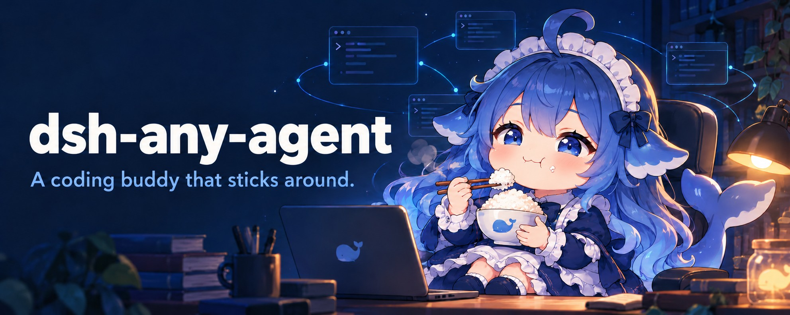
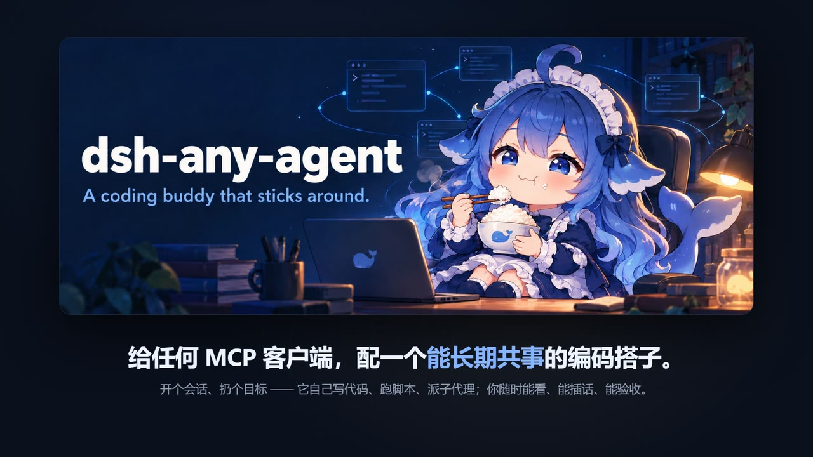
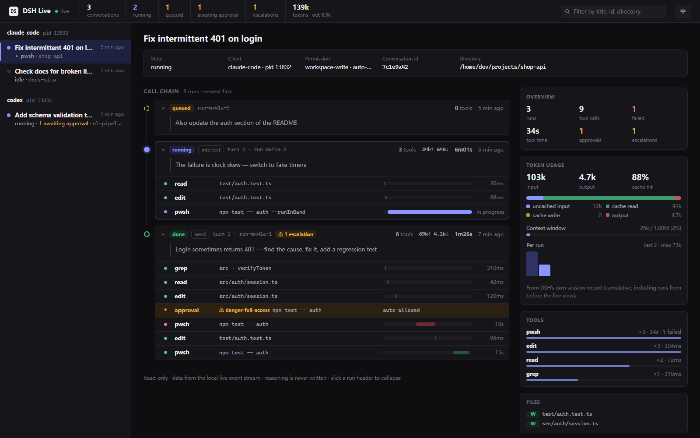

<div align="center">



**Give any MCP client a coding buddy that sticks around.**

**[Website](https://dsh-any-agent.xmtlz.dev/)** · **English** · [简体中文](README.zh.md)

[](https://www.npmjs.com/package/dsh-any-agent)
[](https://nodejs.org)
[](LICENSE)
[](package.json)
[](https://github.com/xmtlzzz/dsh-any-agent/actions/workflows/tests.yml)

[Website](https://dsh-any-agent.xmtlz.dev/) · [Quick start](#quick-start) · [Features](#-why-its-different) · [Tools](#-tools) · [Live view](#-live-view-see-what-the-dispatched-work-is-doing) · [Usage notes](USAGE-NOTES.en.md) · [Changelog](CHANGELOG.md)

</div>

🧪 Offline suite green in CI on Linux, Windows and macOS · 👀 new live call-chain view (`watch` / `dashboard`, with token usage) · 🔌 MCP over stdio · 📦 Zero dependencies · 📜 MIT

An MCP server that drives DeepSeek Harness as a **long-lived coding agent**. Hand it a goal, let it write code and run scripts, steer it mid-flight, and collect the result when you are ready.

**Claude Code · Claude Desktop · Codex · Cursor · Windsurf · Zed · Gemini CLI · Antigravity · opencode · VS Code** — or any client that speaks MCP over stdio.

## 🎯 The problem this solves

You already have a coding agent in your editor. What you do **not** have is one that can:

- **hand a multi-hour job to another agent and walk away** — then collect the result when it's done;
- **keep the job alive across restarts** of your editor, your session, your machine's idle reap;
- **cut in mid-flight** when it's going the wrong way, without destroying the work;
- **run several of them at once** and switch between them;
- **see what it is doing** without asking the agent — which tools it called, which approvals went through, how many tokens it spent.

DSH (DeepSeek Harness) can do all of that — it has file/shell tools, skills, subagents and workflows — but it is a GUI-first application. Its own `sdk` profile exposes only 3 requests and can't resume, cancel, or answer approvals.

**This server is the missing adapter:** it makes DSH into a *well-behaved background agent* that any MCP client can hire, supervise and collect from.

> Think of it as `&job` — like `&` in a shell, but for an agent.

## ✨ Why it's different

| Capability | What you get |
|---|---|
| 🔄 **A dead process never kills a conversation** | The identity lives on disk. A crash, an idle reap, even restarting this whole server costs you nothing — the next call transparently resumes it, memory intact (verified across processes). |
| 🗣️ **You are never stuck waiting** | Steer a conversation mid-flight — **interject** to stop and redirect (~100 ms to reach idle, measured over four cancelled turns), or **queue** a remark for after the current turn. Interrupting never damages the conversation. |
| 📡 **Completion notification, not polling** | Long tasks return instantly with a `run_id`; when the turn ends, a **sentinel file** is written atomically so a background task in *your* host wakes you. No polling, no occupied turn. |
| 🪟 **Many conversations at once** | `dsh_list(only_running)` shows what's live; `dsh_read` gives cursor-based incremental output. Cycle between them like windows. |
| 👀 **You can see it yourself** | `dsh-any-agent watch` (terminal) or `dsh-any-agent dashboard` (local read-only web page) lays dispatched work out as a call chain — client → conversation → run → tool calls / approvals — with per-run tokens and context-window use, updating while the run is going. Separate processes, never touch the write lock, and show work from every client together. |
| 🧠 **Reasoning hidden by default** | You get "thought for N chars / M seconds" statistics instead of context-burning prose — and it is never logged, never written to disk. |
| 🤫 **Silent by default** | Not one byte on stderr, so nothing pollutes your host's logs. stdout carries the protocol and nothing else. |
| 🧩 **Capabilities compose** | DSH can mount its own MCP servers (IDA Pro, browsers, your internal tooling), so this is a bridge to a whole toolbox. |
| 🛡️ **Read-only that really is read-only** | `read-only` sandbox plus auto-denied approvals, for working on untrusted samples. |
| 🔎 **Caller review, not blind relay** | Every result carries a `review` ticket (checklist + evidence + `dsh_review` entry). The caller verifies with its own tools, then records `pass` / `partial` / `fail`. Advisory by default — it never blocks the next dispatch, and a failed review is not silently fed back to DSH. |

## 🧭 Positioning: a dispatcher, not a capability aggregator

**This server dispatches; it does not re-implement what DSH already does.** The caller
gives a goal, and DSH decides which tools, skills, subagents or team to use. Nothing
from DSH's tool surface is proxied, duplicated or preloaded.

| Owned by DSH (this server stays out) | Owned by this server (dispatch semantics) |
|---|---|
| File I/O, shell, search, editing | Session identity and cross-crash resume |
| Skills, subagents, Agent Teams, task board | Async dispatch, receipts, completion sentinels |
| Model routing, sandbox, approval policy | Incremental read, interject, interrupt, live call-chain view |
| Memory/context/compaction | Approval bridge, write-lock governance, queue, inbox |
| worktrees (the agent creates them with git) | Setup, status, doctor, audit |

**Dispatch on demand**: `dsh_send` passes a goal, not a tool manifest, and the caller
does not need to know DSH's tool list. The DSH agent picks what it needs — including
capabilities added after this server was built (for example the experimental Agent
Teams). This server does not grow one MCP tool per DSH feature.

**Team mode (opt-in since 0.5.0)**: off by default. Run `dsh-any-agent team on`
and reconnect; the profile switches to `dsh-team` (the experimental Agent Teams
packages), and `dsh_send` then adds a short "form a team if this needs parallel or
multi-role work" line; simple tasks are not forced into a team. Turn it off with
`dsh-any-agent team off`, or for one call with `dsh_send(team=false)`. The team
profile disables the legacy `subagent` tools and replaces them with nine team
tools; teammates share one workspace.

**Only dispatch semantics become tools**: start, send, read, get, review, interject,
interrupt, approve, queue, inbox, status, release, takeover, doctor. No file I/O, no
shell, no editor, no task board.

**When to add something outside DSH**: only when you need a *guarantee* rather than a
*behavior* — for example, several top-level sessions editing the same repository need
outer worktree isolation. For collaboration, prefer letting DSH run the team itself
(mount the experimental team packages into the profile; teammates share one workspace).

## Quick start

Requires **Node.js ≥ 22.15** and **DSH installed with a working model route and credentials**. See [Requirements](docs/en/install.md) for details.

```bash
npm install -g dsh-any-agent
dsh-any-agent-setup
dsh-any-agent-setup --yes
```

The second command previews the changes; `--yes` applies them. Reconnect your client's MCP server, then ask your agent to start a DSH conversation in your project, dispatch a task, and collect the result. The [dispatch workflow](docs/en/usage.md) shows the tool sequence.

Only using Cursor or VS Code? Add it in one click instead (runs `npx -y dsh-any-agent@latest`; DSH still has to be installed):

[](https://cursor.com/install-mcp?name=dsh-any-agent&config=eyJjb21tYW5kIjoibnB4IiwiYXJncyI6WyIteSIsImRzaC1hbnktYWdlbnRAbGF0ZXN0Il19)
[](https://vscode.dev/redirect/mcp/install?name=dsh-any-agent&config=%7B%22name%22%3A%22dsh-any-agent%22%2C%22type%22%3A%22stdio%22%2C%22command%22%3A%22npx%22%2C%22args%22%3A%5B%22-y%22%2C%22dsh-any-agent%40latest%22%5D%7D)

> **Want to see it first?** Watch the [54-second promo](https://dsh-any-agent.xmtlz.dev/en/#video) — dispatch, interject, the sentinel landing and the caller's review, with the terminal replayed from a real run:
>
> <a href="https://dsh-any-agent.xmtlz.dev/en/#video"></a>

> **Before your first task:** read the [Usage Notes](USAGE-NOTES.en.md), especially the model-config and external-MCP permission boundaries. External MCP tools bypass DSH's sandbox. For a fresh machine, follow the [migration guide](USAGE-MIGRATION.en.md).

<details>
<summary>Full contents</summary>

- **Quick start** — [Install and connect](#quick-start) · [Changelog](CHANGELOG.md)
- **Start here** — [The problem](#-the-problem-this-solves) · [Why it's different](#-why-its-different) · [Why not just wrap the DSH CLI](docs/en/architecture.md) · [Requirements](docs/en/install.md) · [Setup](docs/en/install.md)
- **Using it** — [Tools](#-tools) · [Live view](#-live-view-see-what-the-dispatched-work-is-doing) · [Dispatch then collect](docs/en/usage.md) · [Completion notifications](docs/en/usage.md) · [Many conversations](docs/en/usage.md)
- **Behavior** — [Permissions](docs/en/security.md) · [Reasoning](docs/en/usage.md) · [Logging and privacy](docs/en/security.md) · [Workspace & GUI](docs/en/security.md)
- **Hard parts** — [The write lock](docs/en/locking.md)
- **Reference** — [Environment](docs/en/reference.md) · [Tests](docs/en/tests.md) · [Known limitations](docs/en/limits.md) · [Why the old profile name?](docs/en/limits.md)

</details>

## 🧰 Tools

| Tool | What it does |
|---|---|
| `dsh_start` | Create a conversation: workspace, permission tier, approval policy, **reasoning effort (default `max`)**, model |
| `dsh_send` | Hand it a task. **Defaults to `wait=false`: returns a `run_id` + `sentinel_file` immediately**, the turn runs in the background and the sentinel file notifies you when it's done (recommended). `wait=true` blocks until the turn ends; hitting `timeout_ms` (default `0` = wait forever) **only downgrades to background — the turn is never cancelled and the result is never lost** |
| `dsh_list` | All conversations with live state: `running` / `idle` / `detached`, elapsed time, current tool, output so far. `only_running=true` for active ones |
| `dsh_read` | **Cursor-based incremental read** of what a *running* conversation is producing right now. The cursor is a **revision number**: an entry whose text grew since your last read reappears — match it by `seq` and replace its text, don't append again |
| `dsh_get` | Conversation details; with `run_id`, the **final result of that dispatch** (the "collect the result later" entry point) **plus its review ticket**. Run records live in memory (last 20) — use the sentinel file after a restart |
| `dsh_review` | **Caller review.** Submit `pass` / `partial` / `fail` for a completed run, with notes and optional findings. The verdict is written to `<state dir>/reviews/<conversation_id>/<run_id>.review.json` and back into the in-memory run and sentinel. Advisory by default: it never blocks the next `dsh_send` |
| `dsh_interject` | Interject while it's busy: `interject` = stop and redirect, `queue` = wait for the current turn, then speak. **This round writes a sentinel too**, and the reply carries its `sentinel_file`. In both modes, and on an idle conversation, it **blocks until the new turn ends**; to queue without blocking, use `dsh_send(queue=true)` |
| `dsh_takeover` | **Preempt the write lock.** The only way out when another DSH process holds it (DSH has no steal API — preempting means killing the holder). It classifies the holder first: our own orphaned child → taken automatically; another live instance → needs `force`; **GUI/unknown → never killed**, reported instead |
| `dsh_interrupt` | Stop the current turn without sending anything new (the conversation stays healthy); to stop and redirect, use `dsh_interject` |
| `dsh_release` | Hand the conversation back (frees the write lock so you can open it in your own DSH GUI). Still resumable; `forget=true` writes a tombstone — by-id lookups are refused until you delete `$DSH_HOME/.dsh-any-agent-forgotten/<id>.json` |
| `dsh_approval_decide` | Adjudicate a pending approval (only when `on_approval=ask`) |
| `dsh_status` | Lightweight status check (single conversation), including the write-lock holder `lock_holder` |
| `dsh_inbox` | **Cross-conversation approval inbox**: every pending approval with reason, input and age; decide with `dsh_approval_decide` |
| `dsh_queue` | Inspect/modify the session queue: `list` / `remove` / `update` / `promote` (created by `dsh_send(queue=true)`, memory only) |
| `dsh_doctor` | Read-only health check: DSH version, profile, state/dir writability, orphan locks, sessions and RSS, effective config |

Every tool declares all four MCP annotations (`readOnlyHint`, `destructiveHint`, `idempotentHint`, `openWorldHint`). Six only read state and are marked read-only: `dsh_list`, `dsh_read`, `dsh_get`, `dsh_status`, `dsh_inbox`, `dsh_doctor`. Tool titles, descriptions and the server instructions come in English and Chinese: they follow your system language, or set `DSH_MCP_LANG=en|zh`. Tool results follow the same setting; a few less common error messages are still Chinese only.

## 👀 Live view: see what the dispatched work is doing

The tools above are for the **calling agent**. **You**, sitting at the client, usually see one `dsh_send` and nothing else. Since 0.6.1 the server writes each conversation's activity to a local event stream, so you can watch the call chain **without going through the agent**:

```text
claude-code  pid 8328
└─ e896d16a  temperature module  running · total 278k/17k · context 3%
   ├─ ✓ run-…-1  [send] · done · 1m24s · 8 tools · 69k↑ 4.1k↓ tok
   └─ ▶ run-…-2  [queue] · running · 156k↑ 12k↓ tok
         ✓ read   temp.js                  13ms
         ✓ edit   temp.js                  18ms
         ◆ approval auto-allow ⚠ danger-full-access  node --test
         ▶ pwsh   node --test
```

```bash
dsh-any-agent watch
```

```bash
dsh-any-agent dashboard --open
```



- **`watch`**: the call chain in your terminal, redrawn in place like `top` (no scrolling spam). `watch <conversation id prefix>` follows one conversation; `--once` prints once and exits.
- **`dashboard`**: a local read-only web page; `--open` launches it in your default browser. Left: conversations grouped by client. Middle: the run timeline, with a timing bar per tool call and approvals/escalations highlighted. Right: overview, tool breakdown, files touched, approvals, and **token usage** (input / output / cache hit, context window, per-turn chart).
- **English / 中文**: follows your system language by default; pass `--lang en|zh` to choose, or switch from the page's top-right corner.
- **Doesn't disturb running work**: both are separate processes that only read event files — they never touch the write lock or DSH. Use them to watch progress, and **don't open MCP-driven conversations in the DSH GUI** (that takes the write lock; see [usage notes 3.10](USAGE-NOTES.en.md)).
- **Safety and privacy**: the dashboard binds `127.0.0.1` only, its URL carries a one-time token, it checks the Host header, and it has no control that changes state. Command, path and prompt previews are redacted first; **reasoning is never written at any level**. `DSH_MCP_LIVE=meta` keeps only tool names and status; `off` disables it.

> Details in [Usage · side view](docs/en/usage.md); event format and design trade-offs in the [live view design](docs/en/live-view-design.md).

## 📚 Documentation map

| Document | Contents |
|---|---|
| [Setup](docs/en/install.md) | Requirements, profile bootstrap, 9 MCP clients |
| [Usage](docs/en/usage.md) | Dispatch/collect, sentinels, many conversations, live view, reasoning |
| [Live view design](docs/en/live-view-design.md) | Event stream format, `watch` / `dashboard`, token source, privacy trade-offs |
| [Team mode](docs/en/team.md) | Default behavior, how to disable (per client), verify and revert |
| [Permissions & privacy](docs/en/security.md) | Tiers, approvals, GUI visibility, logging |
| [Write lock](docs/en/locking.md) | Four holder classes, takeover, GUI contention |
| [Environment variables](docs/en/reference.md) | Every switch and its default |
| [Tests](docs/en/tests.md) | Offline/integration suites and coverage |
| [Known limitations](docs/en/limits.md) | Limits, profile naming |
| [Compatibility](docs/en/compatibility.md) | DSH version matrix, team-package requirements, upgrade checks |
| [Architecture](docs/en/architecture.md) | Why ACP, sdk/plugin comparison |
| [Release process](docs/en/release.md) | Release checklist |

## 🧑‍🤝‍🧑 Team mode (opt-in)

Off by default. Run `dsh-any-agent team on` and reconnect; the profile switches
to `dsh-team` (the experimental Agent Teams packages) and `dsh_send` adds a
short "form a team when this needs parallel or multi-role work" line. Simple
tasks are not forced into a team. Turn it off with `dsh-any-agent team off`, or
for one call with `dsh_send(team=false)`.

> Full steps (commands, verification, rollback) are in [Team mode](docs/en/team.md).

## 📇 Listed on

<!-- Directory and registry badges live here, not in the header (which keeps only the package's own status).
     One 20px badge per line, alphabetical; prefer a site's small badge over its large card. -->

<p align="center">
  <a href="https://glama.ai/mcp/servers/xmtlzzz/dsh-any-agent"></a>
  <a href="https://m8ven.ai/mcp/xmtlzzz-dsh-any-agent-ypgfnj?s=readme"></a>
  <a href="https://mcprush.com/to/dsh-any-agent-mcp?ref=badge"></a>
</p>

## 🙏 Acknowledgements

dsh-any-agent started from [Moer2831/Deepseek-DSH-MCP](https://github.com/Moer2831/Deepseek-DSH-MCP) (MIT), where this server was called `dsh-mcp`. The ACP client, the session hub, write-lock handling, sentinel files, `DESIGN.md` and the first test suites come from that project; client setup and restore, team mode, the live view, caller review and the release pipeline were added here. The original copyright notice is kept in [LICENSE](LICENSE).

## Star History

<a href="https://www.star-history.com/?repos=xmtlzzz%2Fdsh-any-agent&type=date&legend=top-left">
 <picture>
   <source media="(prefers-color-scheme: dark)" srcset="https://api.star-history.com/chart?repos=xmtlzzz/dsh-any-agent&type=date&theme=dark&legend=top-left" />
   <source media="(prefers-color-scheme: light)" srcset="https://api.star-history.com/chart?repos=xmtlzzz/dsh-any-agent&type=date&legend=top-left" />
   
 </picture>
</a>
