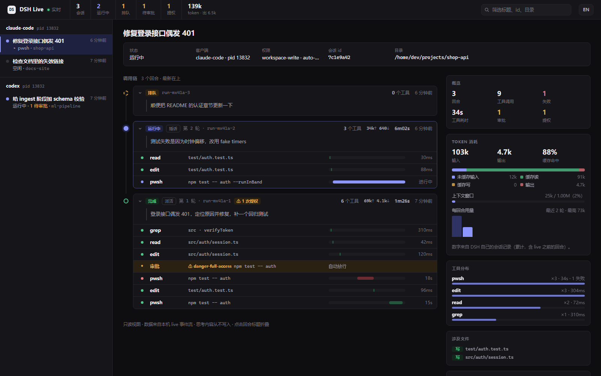

<div align="center">


**给任何 MCP 客户端配一个能长期共事的编码搭子。**

**[官网](https://dsh-any-agent.xmtlz.dev/)** · [English](README.md) · **简体中文**

[](https://www.npmjs.com/package/dsh-any-agent)
[](https://nodejs.org)
[](LICENSE)
[](package.json)
[](https://github.com/xmtlzzz/dsh-any-agent/actions/workflows/tests.yml)
[](https://m8ven.ai/mcp/xmtlzzz-dsh-any-agent-ypgfnj?s=readme)

[官网](https://dsh-any-agent.xmtlz.dev/) · [快速开始](#快速开始) · [主要优势](#-主要优势) · [工具](#-工具) · [实时查看](#-实时查看派出去的活在干什么) · [使用注意事项](USAGE-NOTES.md) · [更新日志](CHANGELOG.md)

</div>

🧪 离线套件在 CI 中全绿（Linux / Windows / macOS）· 👀 新增实时调用链视图（`watch` / `dashboard`，含 token 用量）· 🔌 MCP over stdio · 📦 零依赖 · 📜 MIT

一个 MCP 服务端，把 DeepSeek Harness 当作**长驻的编码 agent** 来驱动。开个会话、扔个目标，它自己写代码、跑脚本、派子代理；你随时能看、能插话、能回头验收。

**Claude Code · Claude Desktop · Codex · Cursor · Windsurf · Zed · Gemini CLI · opencode · VS Code**，以及任何支持 MCP over stdio 的客户端。

## 🎯 解决什么问题

你的编辑器里已经有一个编码 agent 了。你**没有**的是这样一个 agent：

- **把几小时的长活交给它，然后走开** —— 回头再来收结果；
- **跨重启不丢** —— 编辑器重启、会话断开、机器空闲回收，任务都还在；
- **跑偏时能中途插话** —— 改口、打断，而不毁掉已经做的工作；
- **同时跑好几个**，像切窗口一样轮流盯；
- **看得见它在干什么** —— 不用问 agent，自己就能看到它调了哪些工具、批了哪些审批、花了多少 token。

DSH（DeepSeek Harness）本身**全都能做** —— 它有文件/shell 工具、技能、子代理、workflow —— 但它是个 GUI 优先的应用。它自带的 `sdk` profile 只暴露 3 个请求，不能 resume、不能 cancel、不能应答审批。

**这个服务就是缺的那层适配器：** 把 DSH 变成一个*守规矩的后台 agent*，任何 MCP 客户端都能雇它、盯它、收它的活。

> 可以理解成 shell 里的 `&` —— 只不过后台跑的是个 agent。

## ✨ 主要优势

| 能力 | 你能得到什么 |
|---|---|
| 🔄 **进程死了对话也不丢** | 对话身份在磁盘上。进程崩溃、被空闲回收、甚至整个服务重启，都不影响继续——下次调用自动 `resume`，记忆完整（跨进程实测）。 |
| 🗣️ **不用傻等** | 回合跑偏了能**插话改口**（约 100ms 收敛到 idle，四次打断实测），或**排队**等这轮跑完再说；打断后会话不损坏。 |
| 📡 **跑完自动通知** | 长任务 `wait=false` 立刻返回 `run_id`；回合结束时**原子写出哨兵文件**，用你宿主的后台任务等它即可。不轮询、不占轮次。 |
| 🪟 **多会话并发** | `dsh_list(only_running)` 看谁在跑，`dsh_read` 游标式增量读——像切窗口一样轮流盯。 |
| 👀 **你自己就能看见** | `dsh-any-agent watch`（终端）或 `dsh-any-agent dashboard`（本地只读网页）把派出去的活展开成调用链：客户端 → 会话 → 回合 → 工具调用 / 审批，带每回合 token 与上下文占用，回合进行中实时更新。独立进程、不碰写锁，所有客户端派的活一起看。 |
| 🧠 **灰色思考默认隐藏** | 只给"想了 N 字 / M 秒"的统计，不烧上下文；**本服务不写日志、不落盘**（DSH 自己的会话日志仍含思考，见“日志与隐私”）。 |
| 🤫 **默认完全静默** | 一个字节都不输出，不污染宿主日志；stdout 只走协议。 |
| 🧩 **能力可叠加** | DSH 自己还能挂别的 MCP（IDA Pro、浏览器、内部工具）——这是一座通往整个工具箱的桥。 |
| 🛡️ **只读档真能只读** | `read-only` 沙箱 + 审批一律拒绝，适合分析不信任样本。 |
| 🔎 **让调用方审核，而不是盲转述** | 每个结果都带 `review` 审核单（清单 + 证据 + `dsh_review` 入口）。调用方用自己的工具核验后记录 `pass` / `partial` / `fail`。默认 advisory：不阻塞下一次派活，审核不通过也不会被悄悄回灌给 DSH。 |

## 🧭 定位：本服务只负责"派活"，能力复用 DSH

**它不是能力聚合器，而是派发层。** DSH 已经有的能力，本服务默认不重做、不代理、不预加载——
调用方给一个目标，DSH 自己决定用哪些工具、技能、子代理或团队。

| 归 DSH 管（本服务不碰） | 归本服务管（派发语义） |
|---|---|
| 文件读写、shell、搜索、编辑 | 会话身份与跨崩溃 resume |
| 技能、子代理、Agent Teams、任务板 | 异步派活、收据、完成哨兵 |
| 模型路由、沙箱、审批策略 | 增量读、插话、中断、实时调用链视图 |
| 记忆/上下文/压缩 | 审批桥、写锁治理、队列、收件箱 |
| worktree（agent 自己用 git 建） | 安装、状态、体检、审计 |

**按需派发**：`dsh_send` 只传目标，不传工具清单，也不要求调用方先了解 DSH 有哪些工具。
DSH 的 agent 按任务自己选能力——包括它自己新长出来的能力（比如实验性 Agent Teams），
本服务不需要为每一个新能力加一个 MCP 工具。

**团队模式（0.5.0 起按需开启）**：默认关闭。运行 `dsh-any-agent team on` 并重连后，
profile 切到 `dsh-team`（含实验性 Agent Teams），`dsh_send` 会提示"需要时先建团队"，简单任务不组队。
关闭：`dsh-any-agent team off`；单次关闭：`dsh_send(team=false)`。
注意 team profile 会关闭旧的 `subagent` 工具，换成 9 个团队工具；成员共享一个工作区。

**只有"派发语义"本身需要的才做成工具**：建会话、派活、读进度、验收、审核、插话、中断、审批、
队列、收件箱、状态、释放、抢占、体检。文件读写 / shell / 编辑器 / 任务板都不做。

**什么时候需要外层再加东西**：只有当你需要"保证"而不是"行为"时——
例如多个顶层会话并发改同一个仓库，需要外层 worktree 隔离；团队协作则优先让 DSH 自己开团队
（需要把实验性 team 包挂进 profile，成员共享一个工作区）。

## 快速开始

需要 **Node.js ≥ 22.15**，并且**已安装 DSH、配置好可用的模型路由与凭据**。详见[前置要求](docs/zh/install.md)。

```bash
npm install -g dsh-any-agent
dsh-any-agent-setup
dsh-any-agent-setup --yes
```

第二条命令只预览，加 `--yes` 才会写入配置。重新连接客户端的 MCP 服务，然后让你的 agent 在当前项目中开启 DSH 会话、派活、收结果。[先派活，回头验收](docs/zh/usage.md)展示了完整的工具调用顺序。

> **第一次派活前：** 先读[使用注意事项](USAGE-NOTES.md)，尤其是模型配置与外部 MCP 的权限边界。**外部 MCP 工具的副作用不受 DSH 沙箱约束。** 新机器部署可按[迁移指引](USAGE-MIGRATION.md)逐步操作。

> **想先看效果？** 先看 [54 秒宣传片](https://dsh-any-agent.xmtlz.dev/#video)（派活、插话、哨兵落地、调用方复核，终端画面回放自一次真实运行）：
>
> <a href="https://dsh-any-agent.xmtlz.dev/#video"></a>
>
> 再自己跑一遍：`npm run demo` 是一条能跑通的 5 分钟路径：派活 → 中途插话两次 → 脚本自己复核产物（连 `node --test` 都替你跑）。不想花 token 就先 `npm run demo -- --replay`。见 [5 分钟案例](docs/zh/demo.md)。

<details>
<summary>展开完整目录</summary>

- **快速开始** —— [安装并连接](#快速开始) · [更新日志](CHANGELOG.md)
- **先看这里** —— [解决什么问题](#-解决什么问题) · [主要优势](#-主要优势) · [为什么不是包一层](docs/zh/architecture.md) · [前置要求](docs/zh/install.md) · [安装配置](docs/zh/install.md)
- **怎么用** —— [工具](#-工具) · [实时查看](#-实时查看派出去的活在干什么) · [先派活回头验收](docs/zh/usage.md) · [跑完自动通知](docs/zh/usage.md) · [多会话并发](docs/zh/usage.md)
- **行为** —— [权限](docs/zh/security.md) · [思考内容](docs/zh/usage.md) · [日志与隐私](docs/zh/security.md) · [工作区与 GUI](docs/zh/security.md)
- **难点** —— [写锁](docs/zh/locking.md)
- **参考** —— [环境变量](docs/zh/reference.md) · [测试](docs/zh/tests.md) · [已知限制](docs/zh/limits.md) · [为什么还叫旧 profile 名？](docs/zh/limits.md)

</details>

## 🧰 工具

| 工具 | 作用 |
|---|---|
| `dsh_start` | 建会话：工作区、权限档、审批策略、**思考深度（默认 `max`）**、模型 |
| `dsh_send` | 派任务。**默认 `wait=false`：立刻返回 `run_id` + `sentinel_file`**，回合在后台跑，跑完由哨兵文件通知你（推荐）。`wait=true` 才原地阻塞到回合结束；到期（`timeout_ms`，默认 0 = 一直等）**只会转后台，不取消回合、不丢结果** |
| `dsh_list` | 所有会话及运行状态：`running` / `idle` / `detached`，已跑时长、当前工具、本轮输出。`only_running=true` 只看活动会话 |
| `dsh_read` | **游标式增量读**——看正在跑的会话此刻吐出了什么。cursor 是**修订号**：文本被追加过的条目会再次返回，按 `seq` 替换全文（不要重复累加） |
| `dsh_get` | 会话详情；带 `run_id` 时返回**那一次派活的完整结果 + 审核单**（"回头验收"的入口）。run 记录只在内存（最近 20 条），服务重启后请读哨兵文件 |
| `dsh_review` | **调用方审核**。对已完成的 run 提交 `pass` / `partial` / `fail`，可带理由与 findings。裁决写入 `<状态目录>/reviews/<conversation_id>/<run_id>.review.json`，并回写内存 run 与哨兵。默认 advisory：**不阻塞**下一次 `dsh_send` |
| `dsh_interject` | 会话在忙时插话：`interject` 打断并改口，`queue` 等本轮跑完接着说。**这一轮同样会写哨兵**，返回里给 `sentinel_file`。两种模式以及会话空闲时都会**阻塞到新回合跑完**；想排队又不阻塞用 `dsh_send(queue=true)` |
| `dsh_takeover` | **抢占写锁**。锁被别的 DSH 进程占着时的唯一出路（DSH 没有夺锁 API，抢 = 杀掉持有者）。先判定持有者：本服务残留的孤儿 → 自动抢；另一个活着的实例 → 需 `force`；**GUI/未知 → 绝不杀**，只报告 |
| `dsh_interrupt` | 只停下、不说新话（会话不会损坏）；停下并改口用 `dsh_interject` |
| `dsh_release` | 交还会话（释放写锁，之后可在你自己的 DSH GUI 里打开）。仍可 resume；`forget=true` 会写墓碑，此后按 id 查询一律拒绝，直到删除 `$DSH_HOME/.dsh-any-agent-forgotten/<id>.json` |
| `dsh_approval_decide` | 裁决待决审批（仅当 `on_approval=ask`） |
| `dsh_status` | 轻量状态查询（单个会话），含写锁持有者 `lock_holder` |
| `dsh_inbox` | **跨会话待决审批收件箱**：一次列出所有会话的审批、原因、输入与等待时长；裁决仍用 `dsh_approval_decide` |
| `dsh_queue` | 查看/修改会话队列：`list` / `remove` / `update` / `promote`（队列由 `dsh_send(queue=true)` 产生，仅内存） |
| `dsh_doctor` | 只读体检：DSH 版本、profile、状态/目录可写、孤儿锁、会话与 RSS、生效配置 |

每个工具都声明了全部四个 MCP 注解（`readOnlyHint`、`destructiveHint`、`idempotentHint`、`openWorldHint`）。只读取状态的六个标成只读：`dsh_list`、`dsh_read`、`dsh_get`、`dsh_status`、`dsh_inbox`、`dsh_doctor`。

## 👀 实时查看：派出去的活在干什么

上面的工具是给**调用方 agent** 用的。坐在客户端前的**你**，通常只看到一次 `dsh_send`。0.6.1 起，服务会把每个会话的活动写成本地事件流，你可以**不经过 agent** 直接看调用链：

```text
claude-code  pid 8328
└─ e896d16a  温度换算小模块  运行中 · 累计 278k/17k · 上下文 3%
   ├─ ✓ run-…-1  [send] · done · 1m24s · 8 工具 · 69k↑ 4.1k↓ tok
   └─ ▶ run-…-2  [queue] · running · 156k↑ 12k↓ tok
         ✓ read   temp.js                  13ms
         ✓ edit   temp.js                  18ms
         ◆ 审批 auto-allow ⚠ danger-full-access  node --test
         ▶ pwsh   node --test
```

```bash
dsh-any-agent watch
```

```bash
dsh-any-agent dashboard --open
```



- **`watch`**：终端里原地刷新的调用链（同 `top`，不刷屏）。`watch <会话id前缀>` 只看一个会话，`--once` 打印一次就退出。
- **`dashboard`**：本地只读网页，`--open` 直接用默认浏览器打开。左栏按客户端分组列出会话；中间是回合时间线，每次工具调用带一根时间条，审批与提权高亮；右栏是概览、工具分布、涉及文件、审批，以及 **Token 消耗**（输入 / 输出 / 缓存命中、上下文窗口、每回合用量）。
- **中文 / English**：界面默认跟随系统语言，`--lang zh|en` 可指定；网页右上角也能随时切换。
- **不打扰正在跑的活**：两者都是独立进程，只读事件文件，不碰写锁、不连 DSH。想看进度就用它们，**别在 DSH GUI 里点开 MCP 驱动的会话**（那会抢走写锁，见[使用注意事项 3.10](USAGE-NOTES.md)）。
- **安全与隐私**：dashboard 只监听 `127.0.0.1`，地址带一次性 token 并校验 Host 头，没有任何能改变状态的按钮。事件里的命令、路径、prompt 预览都先脱敏；**思考内容任何级别都不写**。`DSH_MCP_LIVE=meta` 只记工具名与状态，`off` 完全关闭。

> 详细说明见 [工具与用法 · 旁路查看](docs/zh/usage.md)，事件格式与设计取舍见 [实时查看设计](docs/zh/live-view-design.md)。

## 📚 文档地图

| 文档 | 内容 |
|---|---|
| [安装与配置](docs/zh/install.md) | 前置要求、profile 引导、9 个客户端注册 |
| [5 分钟案例](docs/zh/demo.md) | 一条能跑通的端到端路径：派活、插话、自己复核 |
| [工具与用法](docs/zh/usage.md) | 派活/验收、哨兵、多会话、实时查看、思考内容 |
| [实时查看设计](docs/zh/live-view-design.md) | 事件流格式、`watch` / `dashboard`、token 来源、隐私取舍 |
| [团队模式](docs/zh/team.md) | 默认行为、关闭步骤（各客户端）、验证与回退 |
| [权限与隐私](docs/zh/security.md) | 权限档、审批、GUI 可见性、日志 |
| [写锁](docs/zh/locking.md) | 四类持有者、takeover、GUI 竞争 |
| [环境变量](docs/zh/reference.md) | 全部开关与默认值 |
| [测试](docs/zh/tests.md) | 离线/集成套件与覆盖 |
| [已知限制](docs/zh/limits.md) | 限制、profile 命名 |
| [兼容性](docs/zh/compatibility.md) | DSH 版本矩阵、团队包要求、升级检查 |
| [架构](docs/zh/architecture.md) | 为什么用 ACP、与 sdk/插件对比 |
| [发布流程](docs/zh/release.md) | 发版清单 |

## 🧑‍🤝‍🧑 团队模式（按需开启）

默认关闭。运行 `dsh-any-agent team on`，重连服务后 profile 切到 `dsh-team`（含实验性 Agent Teams）；
`dsh_send` 会提示"需要并行/多角色时先建团队"，简单任务不组队。
关闭：`dsh-any-agent team off`；单次关闭：`dsh_send(team=false)`。

> 完整步骤（命令、验证、回退）见 [团队模式](docs/zh/team.md)。

## 🙏 致谢

dsh-any-agent 基于 [Moer2831/Deepseek-DSH-MCP](https://github.com/Moer2831/Deepseek-DSH-MCP)（MIT）发展而来，本服务在那里叫 `dsh-mcp`。ACP 客户端、会话中枢、写锁处理、哨兵文件、`DESIGN.md` 以及最初的测试套件都来自该项目；客户端安装与恢复、团队模式、实时调用链视图、调用方审核和发布流程是在这里新增的。原项目的版权声明保留在 [LICENSE](LICENSE) 中。

## Star History

<a href="https://www.star-history.com/?repos=xmtlzzz%2Fdsh-any-agent&type=date&legend=top-left">
 <picture>
   <source media="(prefers-color-scheme: dark)" srcset="https://api.star-history.com/chart?repos=xmtlzzz/dsh-any-agent&type=date&theme=dark&legend=top-left" />
   <source media="(prefers-color-scheme: light)" srcset="https://api.star-history.com/chart?repos=xmtlzzz/dsh-any-agent&type=date&legend=top-left" />
   
 </picture>
</a>
